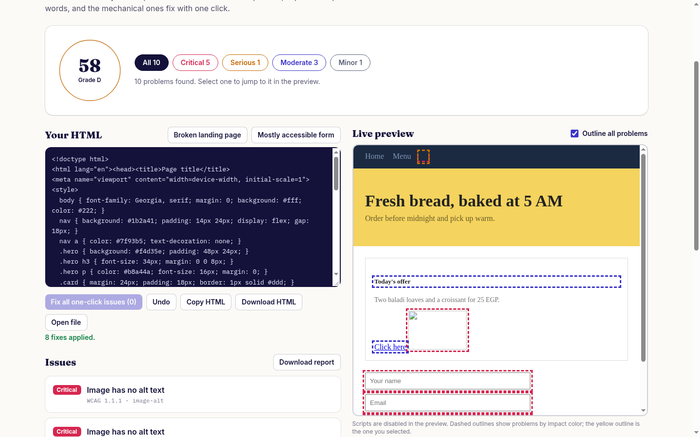

# AccessiCheck

A client-side accessibility checker. Paste HTML and get a WCAG audit with every problem outlined in a live preview, explained in plain words, and fixed in one click where the fix is mechanical.

**Live demo:** https://malakmo7amed309.github.io/accessicheck/



## Standout feature

The audit runs on the real, rendered page. Your HTML loads in a sandboxed preview frame (scripts off) and `src/rules.js` checks the live document, so colour contrast uses true computed styles and inherited backgrounds, not guesses from the source text. Each problem is outlined on the page in its impact colour, and selecting one in the list jumps to it. For low contrast it computes the exact ratio and suggests a passing colour. Fixes edit your HTML directly:

- One click: missing `lang`, missing title, positive `tabindex`, duplicate ids, disabled zoom, autoplay media, focusable `aria-hidden` content, tables without header cells, and low contrast (it sets the suggested colour).
- You type the words: image alt text (or mark it decorative), form labels, button and link names.
- **Fix all one-click issues** applies every one-click fix at once and shows the score change. **Undo** steps back.
- Copy or download the fixed HTML, download the issue list as a Markdown report, or open an `.html` file from disk.

## Rules (17)

Image alt, form labels, button and link names, vague link text, colour contrast (4.5:1, or 3:1 for large text), page language, page title, h1 and heading order, duplicate ids, positive tabindex, aria-hidden on focusable content, table headers, autoplay media, pinch-zoom lock, main landmark. Each one lists its WCAG criterion, why it matters, and how to fix it. The score weights issues by impact.

Automated checks find only part of the problems, so this is a first pass, not a replacement for keyboard and screen reader testing.

## Stack

Preact, Tailwind CSS 4, Vite (single-file build). Fonts: Fraunces, Inter and IBM Plex Mono. No backend; your HTML never leaves the browser.

## Run locally

```
npm install
npm run dev
npm test
```

The build is one self-contained `dist/index.html`, which GitHub Pages serves from `docs/`.
